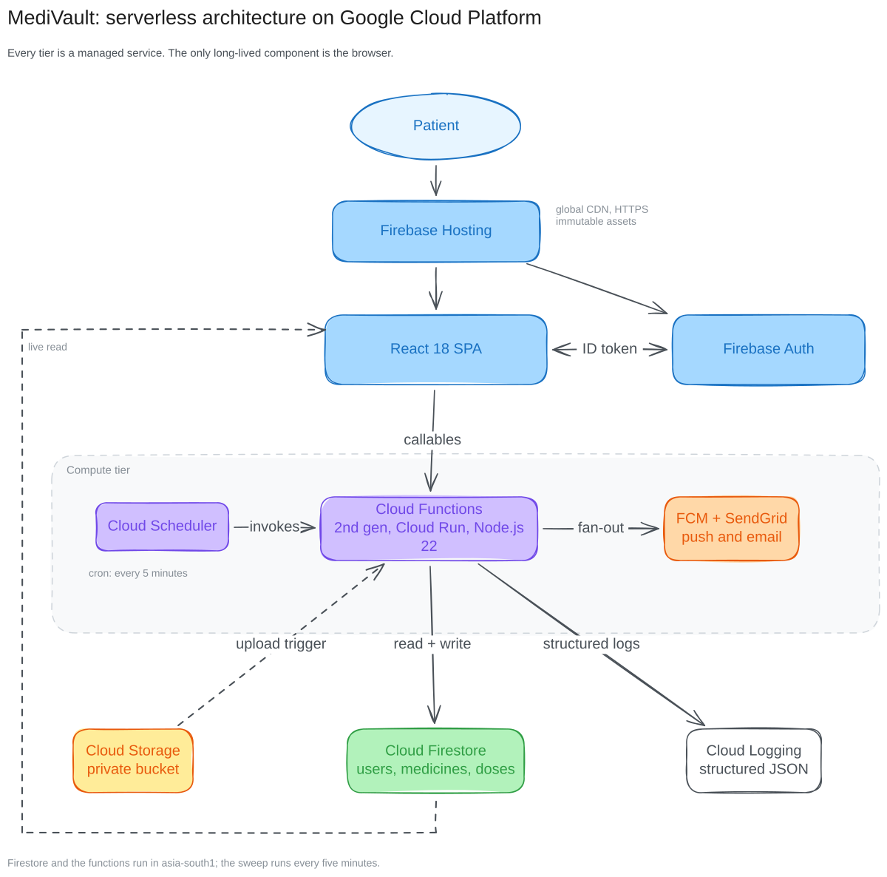

# MediVault

A medication, refill and appointment reminder system for patients, built entirely on managed Google
Cloud services. The browser holds no privileged credential; rules at the data layer and Cloud Functions
make every authoritative decision.

**[Live app](https://medivault-gcp-23875.web.app)** · **[Report](docs/report/MediVault-Report.pdf)** ·
**[Architecture diagrams](docs/architecture/)** · **[Deployment runbook](docs/DEPLOYMENT.md)**



## What it does

| | Feature | How it works |
|---|---|---|
| 1 | Sign in | Google identity through Firebase Authentication. No password is ever handled by the app. |
| 2 | Medicine cabinet | Each medicine stores dosage, form, one or more daily times, tablet count, refill threshold and expiry. |
| 3 | Today's plan | The dashboard lists due doses in the patient's own timezone and updates in every open tab without a refresh. |
| 4 | Take, skip, undo | Written by a Firestore transaction, so two taps or two devices cannot move the stock counter twice. |
| 5 | Warnings | Low stock and expiry alerts, raised by a scheduled sweep and readable in the app. |
| 6 | Appointments | Doctor visits with a reminder 24 hours ahead. |
| 7 | Four channels | One alert document drives an in-app toast, a desktop notification, a web push and an SMS, so the channels cannot disagree. |

Prescription upload and caregiver delegation are deployed and covered by the test suite, but are not
reachable from the interface. The report explains that trade-off in §4.5.

## Cloud services

| Service | Role |
|---|---|
| Firebase Hosting | Serves the built SPA from Google's CDN with HTTPS and a SPA rewrite |
| Firebase Authentication | Google sign-in, short-lived ID tokens |
| Cloud Firestore (Native, `asia-south1`) | System of record, plus the live channel the UI subscribes to |
| Cloud Functions 2nd gen (Node 22, `asia-south1`) | 18 functions: callables, scheduled jobs, a Storage trigger and a health endpoint |
| Cloud Scheduler | `sweepReminders` every 5 minutes, `dailyDigest` at 08:00 UTC |
| Cloud Storage | Private bucket for prescription files, rules-pinned to the owner |
| Firebase Cloud Messaging | Web push for closed tabs |
| Twilio (optional) | SMS reminders to a number verified with Firebase Auth, with a Firestore outbox fallback |
| Cloud Logging / Monitoring | Structured JSON logs and an uptime check on `/api` |

## Repository layout

```text
MediVault/
├── src/                 React 18 + TypeScript client
│   ├── lib/data.ts      live Firestore hooks and the post-write refresh bus
│   ├── lib/api.ts       typed callable wrappers
│   ├── components/      Layout, LiveAlerts, shared primitives
│   └── pages/           Login, Dashboard, Medicines, Appointments, Alerts, Settings, System
├── functions/           Cloud Functions (Node 22)
│   ├── index.js         the 16 exported functions
│   └── lib/             engine, timezone helpers, mailer, push, authorisation
├── firestore.rules      per-user isolation; server-only collections are unwritable
├── firestore.indexes.json
├── storage.rules
├── firebase.json        hosting, headers, emulator ports
├── scripts/             verification suites, diagram and figure generators
└── docs/                report, presentation, runbook, architecture diagrams
```

## Run it locally

Nothing here needs a billing account: the Firebase Emulator Suite provides Auth, Firestore, Storage and
Functions on localhost.

**Prerequisites**

- Node.js 20 or newer (`nvm use 20`)
- Java 11 or newer, for the Firestore and Storage emulators
- npm; the Firebase CLI is used through `npx firebase-tools`

**1. Install**

```bash
git clone https://github.com/<you>/MediVault.git
cd MediVault
npm install
npm --prefix functions install
```

**2. Configure**

```bash
cp .env.example .env.local
```

The defaults in that file point at the emulators and contain no secret. You only need real Firebase Web
SDK values when you deploy; see [Configuration](#configuration).

**3. Start the cloud stack**

```bash
npm run emulators
```

| Emulator | Port |
|---|---|
| Auth | 9099 |
| Firestore | 8080 |
| Functions | 5001 |
| Storage | 9199 |
| Emulator UI | 4000 |

**4. Start the app** (second terminal)

```bash
npm run dev
```

Open <http://127.0.0.1:5173>, sign in, enter a phone number on the first-run step (the emulator
accepts any number and prints the code in its log), then use **Load sample data** on the empty
dashboard. The sample vault is four medicines and two appointments, which is enough to see a dose, a
refill warning and an appointment reminder.

**5. Check the backend**

```bash
npm run verify
```

Thirty assertions run against the emulators with no mocks: real sign-ups, rules evaluation, callable
invocations, a Storage upload and its trigger. The negative cases are asserted too, such as a stranger's
read returning `403` and a `text/plain` upload being refused.

Useful during a demo: **Settings → Send a test alert**, and the operator page at `/system`, which is not
linked from the navigation and shows the region, the Firestore round-trip and the recent scheduled runs.

## Configuration

Every variable is documented in [`.env.example`](.env.example) and
[`functions/.env.example`](functions/.env.example). Copy the example, never commit the result: `.env`,
`.env.local` and `.env.production` are ignored by git.

| Variable | Where | Notes |
|---|---|---|
| `VITE_FIREBASE_*` | `.env.local` / `.env.production` | Web SDK config from `firebase apps:sdkconfig web`. Public by design: access is controlled by Auth and rules, not by hiding these. |
| `VITE_FIREBASE_VAPID_KEY` | same | Optional. Without it the app uses in-app and desktop alerts only. |
| `VITE_USE_EMULATORS` | same | `true` on localhost, `false` in the deployed build. |
| `TWILIO_ACCOUNT_SID` | `functions/.env` | Optional. Without all three Twilio values, composed messages are written to `smsOutbox` with status `logged`. |
| `TWILIO_AUTH_TOKEN` | `functions/.env` | Twilio auth token. |
| `TWILIO_FROM` | `functions/.env` | Sending number in E.164 form, e.g. `+12025550123`. |
| `APP_URL` | `functions/.env` | Public URL used in message links. |

```bash
# functions/.env
TWILIO_ACCOUNT_SID=AC...
TWILIO_AUTH_TOKEN=...
TWILIO_FROM=+1...
```

## Deploy to Google Cloud

```bash
# 1. point the CLI at your project
firebase use --add                  # pick the project, alias it "default"

# 2. build with production config in .env.production, then release
npm run build
firebase deploy --only hosting,functions,firestore:rules,firestore:indexes,storage
```

Or in pieces: `npm run deploy:hosting`, `npm run deploy:functions`, `npm run deploy:rules`.

**Two steps cannot be scripted.** After the first deploy, open the console once and

1. enable the Google provider under **Authentication → Sign-in method**, and
2. add the Hosting domain under **Authentication → Settings → Authorized domains**.

Both are recorded in [`docs/DEPLOYMENT.md`](docs/DEPLOYMENT.md), together with the service-account and
scheduler setup used for the live instance.

To check a deployment rather than the emulators:

```bash
npm run verify:deployed              # public surface: hosting, /api, rules denial
```

The script always checks the deployed hosting bundle, the Cloud Run health endpoint and the
anonymous-denial paths. The signed-in assertions need two real sessions, because Google is the
only enabled provider:

```bash
VERIFY_ID_TOKEN="<patient id token>" VERIFY_CAREGIVER_TOKEN="<caregiver id token>" npm run verify:deployed
```

## Data model

```text
users/{uid}              profile, IANA timezone, notification preferences, FCM tokens
medicines/{id}           name, dosage, times[], remainingTablets, refillThreshold, expiryDate
appointments/{id}        doctor, speciality, location, date, status
doseLogs/{medId_date_hhmm}   status (taken|skipped), who logged it, when
reminders/{dedupeId}     type, title, body, dueAt, channels[]   (engine writes, owner acknowledges)
smsOutbox/{id}           composed text, delivery status, provider
system/status            telemetry for the operator page
```

Reminder identifiers are derived from the alert itself, so a scheduler retry collides with the previous
write instead of notifying twice:

```text
dose_<medicineId>_<YYYY-MM-DD>_<HHmm>
lowstock_<medicineId>_<YYYY-MM-DD>
expiry_<medicineId>_<YYYY-MM-DD>_d<daysLeft>
appt_<appointmentId>_t24
```

## Security

- Firestore rules compare `resource.data.userId` with `request.auth.uid`. There is no branch that trusts
  a client-supplied owner.
- `reminders`, `doseLogs` and `smsOutbox` are `allow write: if false`. Only the Admin SDK inside a
  function can create them, so a browser cannot forge or replay a notification.
- An owner may change only the acknowledgement fields on a reminder.
- Inventory is computed inside a transaction from the previous state; the client sends an intent, never a
  count.
- Storage rules pin the folder to the caller's uid and cap size and content type at 10 MB of image or PDF.
- Input validation runs in every callable, the manual sweep is throttled to once every 20 seconds, and
  functions are capped at ten instances.
- Credentials live in Secret Manager or in untracked env files. No key is committed to this repository.

## Scripts

| Command | Purpose |
|---|---|
| `npm run dev` | Vite dev server |
| `npm run emulators` | Auth, Firestore, Functions, Storage and the emulator UI |
| `npm run build` | Type-check then build to `dist/` |
| `npm run verify` | 30 assertions against the emulator suite |
| `npm run verify:deployed` | Smoke test against the live project |
| `npm run deploy` | Build and deploy everything |
| `npm run diagrams` | Regenerate the Excalidraw diagrams, SVG/PNG renders and report PDFs |
| `npm run figures` | Regenerate the results figures from live telemetry |
| `npm run report` | Compile `docs/report/main.tex` |

## Documentation

- [`docs/report/MediVault-Report.pdf`](docs/report/MediVault-Report.pdf): the submission report, source in
  [`docs/report/main.tex`](docs/report/main.tex).
- [`docs/architecture/`](docs/architecture/): editable `.excalidraw` sources with rendered copies.
- [`docs/DEPLOYMENT.md`](docs/DEPLOYMENT.md): the runbook used for the live instance.
- [`docs/PRESENTATION.md`](docs/PRESENTATION.md): demonstration script.

## Licence

Course project, provided for academic evaluation. The deployed Firebase project, the Twilio account and
the diagrams belong to the team that created them.
